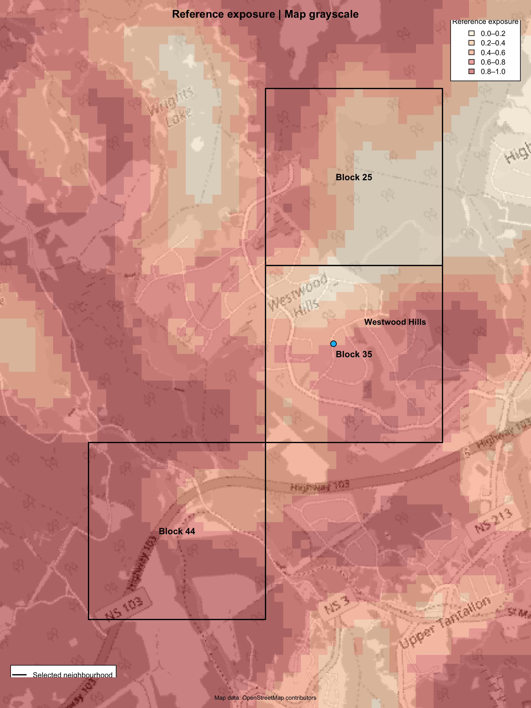
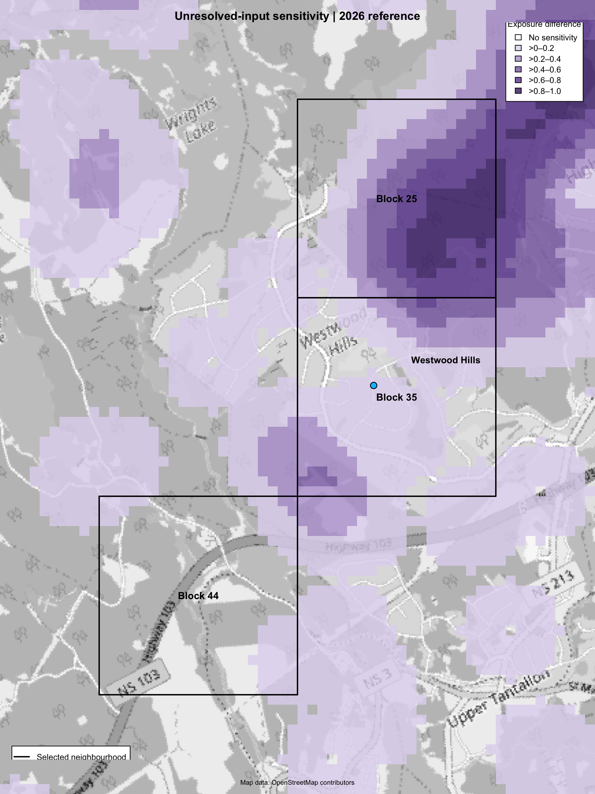
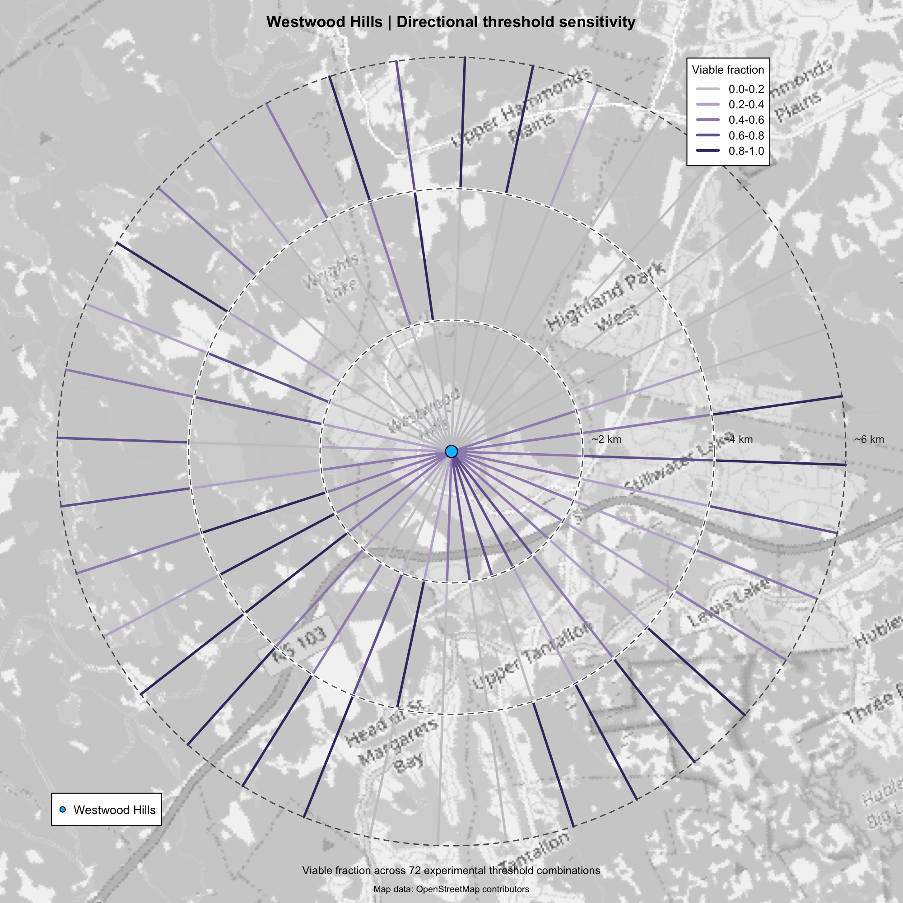
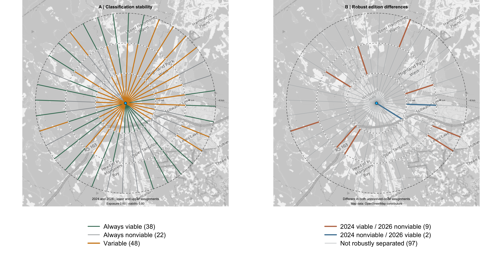

# Representing Uncertainty in Wildfire Exposure Assessments

A reproducible investigation of how landscape evidence, fuel representations, and analytical thresholds affect wildfire exposure estimates and the stability of directional conclusions.

## Overview

Wildfire exposure assessments describe how surrounding landscape conditions may contribute to potential fire exposure at a location. Their results depend on available landscape evidence, how vegetation and fuel types are represented, and the analytical choices used to interpret the calculations.

A single exposure map does not necessarily reveal these dependencies.

This project investigates how those dependencies can be made visible alongside an assessment. Using landscape representations for the Westwood Hills area near Upper Tantallon, Nova Scotia, we examine how differences in mapped fuel classifications, unresolved inputs, and analytical thresholds affect calculated exposure and directional conclusions.

The objective is not to determine which landscape representation is correct or to predict wildfire behaviour. It is to distinguish conclusions that persist under specified assumptions from those that depend on consequential choices.

**Central proposition:** An exposure assessment should communicate not only its conclusions, but also the evidence and assumptions on which those conclusions depend.

## Principal findings

### 1. Directional conclusions depend on landscape representation

We assessed 108 directional segments extending from a reference point near Westwood Hills, using four scenarios constructed from the 2024 and 2026 Canadian Fire Behaviour Prediction (FBP) fuel representations.

For each edition, an unresolved fuel category was assigned alternative binary values. The directional geometry, 500 m exposure calculation, exposure threshold of 0.60, and viability threshold of 0.80 were held constant.

| FBP representation | Lower assignment | Upper assignment |
| --- | ---: | ---: |
| 2024 | 53 viable | 82 viable |
| 2026 | 42 viable | 58 viable |

Across the four scenarios:

| Classification stability | Segments |
| --- | ---: |
| Always viable | 38 |
| Always nonviable | 22 |
| Variable | 48 |

Sixty of 108 directional classifications remained unchanged, while 48 varied under at least one tested scenario.

Of the 48 variable segments, 11 showed differences between editions that persisted under both tested unresolved-category assignments. Nine were viable under both 2024 scenarios but nonviable under both 2026 scenarios; two showed the opposite relationship.

These findings reveal which directional conclusions are conditional on the tested representations and assumptions. They do not establish which representation is more accurate.

### 2. Analytical thresholds introduce a separate dependency

Holding the 2026 reference exposure surface fixed, we evaluated the same 108 directional segments under 72 combinations of exposure and viability thresholds.

Across those combinations:

- 79 segments changed classification.
- Eight remained viable.
- 21 remained nonviable.

This demonstrates that a binary conclusion can conceal substantial sensitivity to the rules used to interpret calculated exposure, even when the exposure surface is unchanged.

The proportion of tested threshold combinations producing a viable classification is not a probability of correctness, exposure, or safety.

### 3. Unresolved landscape information has spatial consequences

The 2026 FBP study window contains 1,326 cells assigned unresolved fuel code 13.

Assigning those cells alternative binary values changed calculated exposure in 14,168 of the 36,100 valid assessment cells.

Because exposure is calculated over spatial neighbourhoods, an unresolved source cell can influence exposure estimates at multiple surrounding locations. The footprint of its analytical influence may therefore extend beyond its own location.

Comparisons with Nova Scotia provincial forest inventory information also reveal differences in how some locations are described, including federal Non-fuel cells overlapping provincially mapped forest.

These observations motivate examination of supporting evidence. They do not establish that either representation is correct or current.

## Visual demonstration

The following figures show complementary aspects of the assessment. They are not components of a combined uncertainty score.

### Reference exposure

*The 2026 reference exposure surface, calculated using a 500 m analytical neighbourhood. Exposure represents a proportion of cells assigned hazardous status, not the probability that a location will burn.*

### Unresolved-input sensitivity

*Change in calculated exposure when unresolved 2026 fuel inputs are assigned one rather than zero. This identifies sensitivity to a specified classification assumption, not total uncertainty or classification error.*

### Directional threshold sensitivity

*Fraction of 72 tested threshold combinations producing a viable classification for each directional segment. These fractions are not calibrated probabilities.*

### Four-scenario directional stability

*Panel A distinguishes directional classifications that remain viable, remain nonviable, or vary across four landscape scenarios. Panel B identifies robust cross-edition differences under the tested unresolved-category assignments. Neither panel identifies safe directions or historical environmental change.*

## Study area and landscape evidence

The study region surrounds the 2023 Westwood Hills / Upper Tantallon wildfire in Nova Scotia, Canada.

The historical fire provides geographic context. This project does not reconstruct the fire, validate its observed behaviour, or evaluate evacuation routes.

The empirical investigation uses:

- The 2024 and 2026 national FBP fuel representations.
- Nova Scotia provincial forest inventory information, including land classification, species descriptions, and source-photography years.

The 2026 study window covers 20 km by 20 km at 100 m resolution.

Different products may reflect different classification systems, evidence sources, observation dates, and update practices. A difference between maps is not automatically an error or observed landscape change.

The 2019 FBP representation was initially considered but is deferred as a possible extension. It is not necessary to establish the present demonstration.

Dataset provenance and fuel-code interpretations are documented in [docs/datasets/](docs/datasets/).

## Experimental approach

The investigation distinguishes three related questions:

1. **Evidence and representation:** What landscape information is available, and how do different mapped descriptions and classification assignments affect calculated exposure?
2. **Analytical interpretation:** How do exposure and viability thresholds affect directional classification when the exposure surface is held fixed?
3. **Conditional stability:** Which directional classifications persist across specified alternative landscape scenarios?

The directional assessment uses 36 bearings at 10-degree intervals, with three successive nominal 2 km segments per bearing, giving 108 directional segments.

D10 varies analytical thresholds using a fixed reference surface. D11.4 fixes the thresholds and geometry while varying FBP edition and unresolved-category assignments.

Experiments use R, `terra`, and `fireexposuR`. The complete chronology, scenario definitions, numerical checks, and reproduction details are maintained in the [experiment log](docs/experiment-log.md).

## Interpretation and limitations

These experiments measure sensitivity and conditional stability under explicitly selected scenarios. They do not measure the total uncertainty of wildfire exposure.

Several distinctions are essential:

- **Classification stability is not evidence reliability.** A stable conclusion can depend on inaccurate, incomplete, or outdated landscape information.
- **Binary stability is not numerical stability.** Continuous directional exposure support may change without crossing the classification threshold.
- **Scenario bounds are not calibrated confidence bounds.** Alternative unresolved-category assignments are experimental assumptions, not validated fire-behaviour parameters.
- **A directional segment is not an operational route.** A viable outer segment does not imply a continuously viable path from the reference point.
- **Differences between FBP editions are not demonstrated historical changes.** The analysis does not identify which edition is correct.
- **Numerical implementation checks are distinct from evidence uncertainty.** D11.4 documents float32 normalization at the classification boundary to preserve consistency with the established calculations.

The earlier synthetic methodology experiments E01–E07 demonstrate related distinctions between exposure support, threshold sensitivity, classification stability, and evidence coverage. In particular, incomplete evidence can coexist with consistent classifications. These synthetic findings are methodological demonstrations, not observations of the Tantallon landscape.

The practical contribution is an inspectable assessment: one that makes conditional conclusions visible and identifies where examining the evidence or analytical assumptions may be worthwhile.

## Additional evidence and methodology

The principal figures are supported by more detailed evidence and methodological records.

**Landscape evidence and provenance**

- [2026 FBP fuel-code register](docs/datasets/fbp-2026-code-register.csv): source-code interpretation and unresolved classifications.
- [2026 FBP WMS verification script](scripts/verify_fbp_2026_wms.py): source verification procedure.
- [Provincial source-photography map](outputs/figures/d04_nonfuel_photo_year_map.png): recorded photography years associated with the provincial evidence examined in D04.

**Synthetic methodology**

- [E07 integrated visualization](outputs/figures/e07_integrated_three_views.png): synthetic demonstration separating exposure, threshold sensitivity, and evidence coverage.

The synthetic demonstrations establish methodological distinctions rather than empirical findings about the Westwood Hills landscape. Their complete results and verification records remain in the experiment log.

## Reproducibility and documentation

This repository maintains experiment scripts, parameter definitions, dataset provenance, numerical tables, figures, and verification records.

Large source geospatial datasets are excluded from Git. Their acquisition sources and processing requirements are documented separately.

Technical material is organized as follows:

- [Experiment log](docs/experiment-log.md): chronological record of experiments, decisions, checks, and limitations.
- [Dataset documentation](docs/datasets/): evidence sources, provenance, and FBP code interpretation.
- [D09 selected figures](docs/d09_selected_figures.md): map definitions and reproduction details.
- [D10 directional visualization](docs/d10_directional_visualization.md): threshold-grid methodology and checks.
- [Scripts](scripts/): maintained analytical and rendering procedures.
- [Output figures](outputs/figures/): generated visualizations.
- [Output tables](outputs/tables/): numerical results where applicable.

**Project status:** Synthetic experiments E01–E07 and empirical experiments through D11.4 are complete and documented. Further expansion, including the 2019 FBP representation, is deferred pending a distinct research question.
