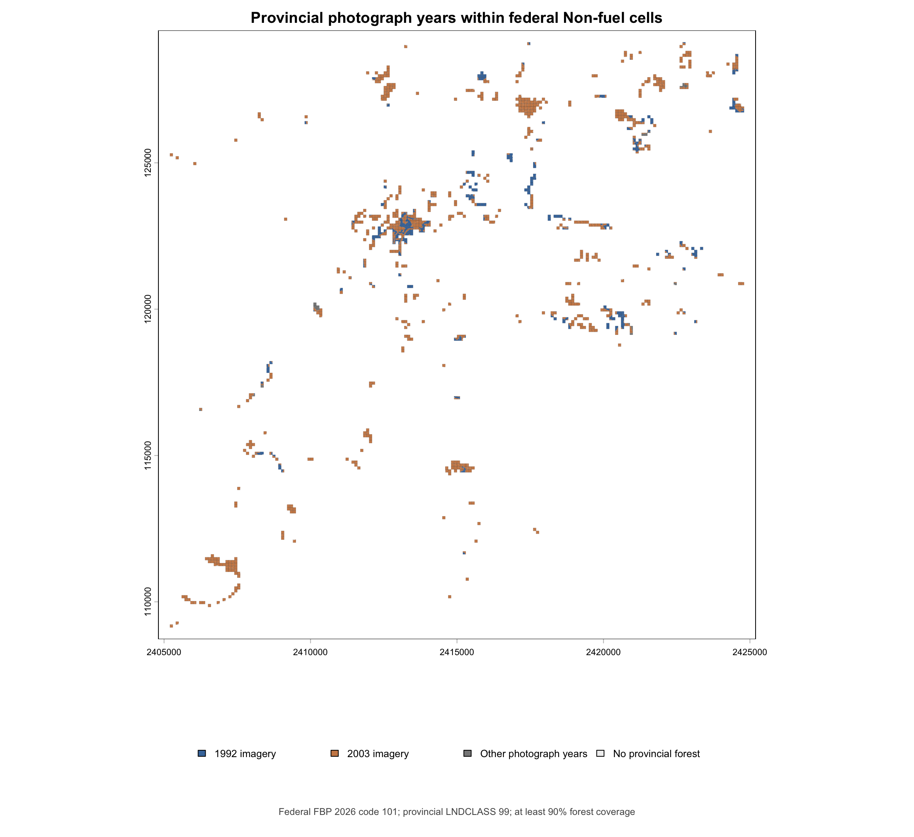
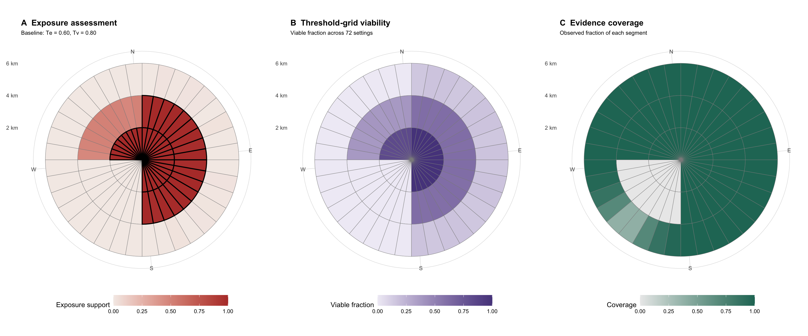

# Representing Uncertainty in Wildfire Exposure Assessments

A reproducible technical investigation of how landscape evidence, fuel representations, and assessment thresholds influence wildfire exposure estimates and the stability of directional conclusions.

## Overview

Wildfire exposure assessments describe how surrounding landscape conditions may contribute to potential fire exposure at a location. However, their results depend on the available evidence, how landscape characteristics are represented, and the parameters used to interpret the calculations.

This project investigates how those dependencies can be measured and communicated alongside conventional exposure results.

The central proposal is to communicate exposure assessments
alongside the evidence and assumptions supporting their conclusions.

The emerging visualization framework distinguishes three views:

1. **Exposure:** What does the assessment indicate about the surrounding landscape?
2. **Threshold sensitivity:** How do directional classifications change under different analytical thresholds?
3. **Evidence coverage:** Where are supporting observations available, incomplete, or missing?

These views are complementary, not components of a single uncertainty score.

An exposure result may remain in the same classification even when its underlying numerical value or distance from a decision threshold changes substantially. Understanding these distinctions is an important part of the investigation.

## Study area

The initial study region surrounds the 2023 Westwood Hills / Upper Tantallon wildfire in Nova Scotia, Canada.

The historical wildfire provides geographic context. This project does not attempt to reconstruct the fire or validate predictions of its behaviour.

## Landscape evidence

The investigation will consider four principal landscape representations:

- Canadian national Fire Behaviour Prediction (FBP) fuel maps from 2019, 2024, and 2026.
- Nova Scotia provincial forest inventory data, including forest composition and land classification.

These products may differ in observation dates, classification methods, spatial resolution, and underlying evidence. Differences between them will not automatically be interpreted as classification errors.

### 2026 FBP fuel-code interpretation

The local 2026 FBP candidate raster has been clipped to a
20 km by 20 km study window containing 40,000 cells at 100 m
resolution.

All 12 numerical codes observed in the study window now have
documented interpretations in
[`docs/datasets/fbp-2026-code-register.csv`](docs/datasets/fbp-2026-code-register.csv).

Verification evidence consists of:

- Nine codes checked at four local raster-cell locations each
  against the official 2026 100 m FBP WMS.
- One code (C-1) checked at its only occurrence in the study window.
- Two codes (11 and 13) interpreted using catalogue documentation.

The reproducible WMS query procedure is implemented in
[`scripts/verify_fbp_2026_wms.py`](scripts/verify_fbp_2026_wms.py).

Important classification distinctions include:

- Code 101: Non-fuel.
- Code 102: Water.
- Code 13: Vegetated fuel without an effective FBP type match.

Complete interpretation of the numerical vocabulary does not
establish current vegetation conditions, source-data accuracy,
or classification stability across different map editions.

## Experimental approach

The investigation is organized into four layers:

1. **Evidence:** Examine source datasets, provenance, coverage, and classification differences.
2. **Representation:** Construct comparable experimental landscape representations while preserving assumptions and missing information.
3. **Exposure:** Calculate continuous and directional exposure assessments using controlled parameters.
4. **Communication:** Develop complementary views of exposure, threshold sensitivity, and evidence coverage.

The initial technical environment uses R, `terra`, and `fireexposuR`.

Completed synthetic experiments include two-dimensional exposure and directional-viability threshold combinations. Future investigations will consider transmission distance and alternative fuel representations.

We will distinguish evidence disagreement, numerical sensitivity, decision-margin sensitivity, and classification stability rather than treating them as a single measure of uncertainty.

## Project status

**Stage: Synthetic methodology validation complete; 2026 federal–provincial landscape evidence comparison completed through D04.**

Synthetic experiments E01–E07 established methods for examining
directional exposure support, threshold sensitivity, and evidence
coverage.

D01–D04 established the study grid, documented 2026 FBP fuel
classifications, characterized provincial evidence coverage, and
examined spatial relationships between federal and provincial
landscape representations.

The 2019 and 2024 FBP comparisons remain planned.

No empirical wildfire exposure assessment has yet been completed
within this project.

## Findings

### Empirical landscape evidence findings

**D03 — Provincial forest evidence coverage**

Provincial forest inventory information was aligned to the
2026 federal FBP study grid using fractional coverage at
100 m resolution.

The analysis distinguishes named species descriptions,
explicitly unclassified species (`UC10`), missing first-story
descriptions, and a clear-cut subset.

These categories describe mapped evidence availability,
not its accuracy or current validity.

**D04 — Federal Non-fuel and provincial forest descriptions**

The 2026 federal FBP raster contains 3,438 Non-fuel cells
(code 101), overlapping approximately 1,315.66 ha of
provincially mapped forest.

Of these, 850 cells have at least 90% provincial forest
coverage. Their vector intersections contain 813.37 ha
of provincial forest descriptions.

Within this area:

- **88.77%** has named species descriptions.
- **3.98%** is explicitly unclassified (`UC10`).
- **7.25%** lacks a first-story species description.
- **77.38%** has `PHOTOYR = 2003`.
- **21.21%** has `PHOTOYR = 1992`.

The vector and raster forest-area estimates differ by
approximately 0.044%.

*Provincial photograph years within the 850 qualifying
federal Non-fuel cells. Colours represent the actual
provincial polygon intersections, not assignments to
entire federal cells.*

**Interpretation:** The federal and provincial products
provide different mapped descriptions of some of the same
locations. Most of the provincial forest area in the
qualifying subset has named species descriptions, but
the underlying photography is predominantly dated
1992 and 2003.

This does not establish that either classification is
incorrect. Classification purpose, source evidence,
observation dates, and update histories may differ.
`PHOTOYR` does not establish forest condition in 2026.

Detailed results and limitations are documented in the
[experiment log](docs/experiment-log.md).

### Synthetic methodology findings

**E01 — Continuous directional support reconstruction**

Using a controlled synthetic exposure boundary, the
reconstructed continuous support measurements reproduced
all 108 binary directional classifications returned by
`fireexposuR::fire_exp_dir()`.

This demonstrates implementation consistency in the tested
configuration, not independent validation of the method.

**E02 — Numerical sensitivity without classification changes**

Increasing a synthetic circular high-exposure region's radius
from 3,500 m to 3,550 m changed the continuous support of
the middle directional segments:

- Mean support increase: 0.02266
- Maximum support increase: 0.05784
- Binary classification changes: 0 of 108

For one segment at 60 degrees, support increased from
0.73505 to 0.79289 while its classification remained
nonviable at a threshold of 0.80.

The experiment demonstrates that continuous support and
decision margins can change without corresponding changes
in binary classification.

**E03 — Direction-dependent classification transitions**

Expanding the synthetic high-exposure region produced
different classification transitions across directional
segments:

- Radius 3,550 m: 0 of 36 middle segments viable
- Radius 3,600 m: 12 of 36 middle segments viable
- Radius 3,650 m: 32 of 36 middle segments viable

Continuous support and binary viability were nondecreasing
across all 108 segment identities.

At 3,600 m, mean middle-segment support remained below
the 0.80 viability threshold, although 12 individual
segments were classified as viable.

The experiment demonstrates that directional conclusions
can change at different tested representation settings,
even under a nominally circular synthetic exposure region.

The precise effects of raster discretization and spatial
intersection geometry have not yet been isolated.

**E04 — Stability across analytical thresholds**

A continuous synthetic exposure surface was assessed
using 72 combinations of exposure and directional
viability thresholds.

The continuous reconstruction reproduced all 7,776
binary classifications returned by `fire_exp_dir()`.

Across the tested threshold grid:

- Inner segments were viable in 59-60 of 72 combinations.
- Middle segments were viable in 27-28 of 72 combinations.
- Outer segments were nonviable in all 72 combinations.

This establishes a *threshold-grid viable fraction*
for each directional segment. The fraction describes
how frequently a segment is classified as viable
under the selected analytical assumptions.

It is not a probability of correctness or a calibrated
measure of uncertainty.

**E05 — Directional stability under heterogeneous exposure**

Introducing a controlled east-west exposure difference
produced directional variation in both continuous support
and threshold-grid viability.

At the baseline thresholds (Te = 0.60, Tv = 0.80),
the eastern middle segment was viable while the western
middle segment was nonviable.

Across 72 threshold combinations:

- East (90 degrees): viable in 44 combinations.
- West (270 degrees): viable in 28 combinations.
- East viable and west nonviable: 16 combinations.
- West viable and east nonviable: 0 combinations.

The paired comparison demonstrates a consistent
directional ordering within the tested threshold grid.

This synthetic result illustrates how spatial
heterogeneity can affect the stability of directional
conclusions, even at equal distances from the
reference point.

**E06 — Missing evidence and directional coverage**

A controlled comparison replaced measured low exposure
with missing raster values while preserving the
high-exposure region.

All 108 binary directional classifications remained
identical between the two representations.

However, evidence coverage differed:

- Measured-low western segments: 100% coverage.
- Missing-evidence western segments: 0% coverage.
- A separate partial-coverage test produced 49.982%
  coverage in the first western segment.

The experiment demonstrates that a nonviable directional
classification does not establish whether exposure
measurements are complete or even available.

We therefore measure *directional evidence coverage*
independently of continuous exposure support and
threshold-grid viability.

Coverage measures the spatial availability of nonmissing
raster values. It does not establish their accuracy,
currency, provenance, or suitability for fire assessment.

These findings concern synthetic representations and should
not be interpreted as measurements of wildfire exposure,
environmental uncertainty, or operational safety.

Detailed methods, results, and limitations are recorded
in the [experiment log](docs/experiment-log.md).

### E07 — Integrated exposure, threshold viability, and evidence coverage

E07 combines three measurements on the same heterogeneous
synthetic exposure landscape, including a deliberately
unobserved southwest region.

The assessment uses 108 directional segments and 72
combinations of exposure and viability thresholds.

Principal results:

- Baseline classification: 45 viable and 63 nonviable segments.
- Evidence status: 81 complete, 18 missing, and 9 partially observed segments.
- Mean directional evidence coverage: approximately 81.33%, compared with 96% overall raster coverage.
- All 27 missing or partially observed segments remained nonviable across the entire threshold grid.
- All 7,776 reconstructed threshold-grid classifications agreed with `fire_exp_dir()`.

The central finding is that **consistent directional classifications
do not necessarily imply complete supporting evidence**.

A missing observation must not be interpreted as a measurement
of low exposure. Likewise, the fraction of threshold settings
producing a viable classification is not a probability of
correctness, safety, or actual exposure.

#### Integrated directional visualization

*Figure: Three views of the same synthetic directional assessment.
Panel A shows high-exposure support, with black outlines marking
segments viable at baseline thresholds Te = 0.60 and Tv = 0.80.
Panel B shows the fraction of 72 threshold combinations producing
a viable classification. Panel C shows available evidence coverage.
The southwest evidence gap is deliberately introduced and does not
represent observations from the Westwood Hills wildfire.*

The detailed experimental design, numerical checks, and limitations
are recorded in [`docs/experiment-log.md`](docs/experiment-log.md).

## Reproducibility

The project will maintain analysis scripts, parameter configurations, dataset provenance records, numerical results, figures, and experiment notes.

Large source datasets will not be distributed directly through Git. Official acquisition sources, relevant versions, and processing instructions will be documented.

## Documentation

Technical documentation and a chronological research record are maintained in [docs/](docs/).

The [experiment log](docs/experiment-log.md) records completed steps, important decisions, and unresolved questions.

## Limitations

This project investigates the sensitivity and stability of exposure representations. Stability should not be interpreted as a calibrated probability of correctness or as a measure of operational safety.

Alternative fuel weights and composition-based representations, where used, will be identified as experimental assumptions rather than validated fire-behaviour parameters.