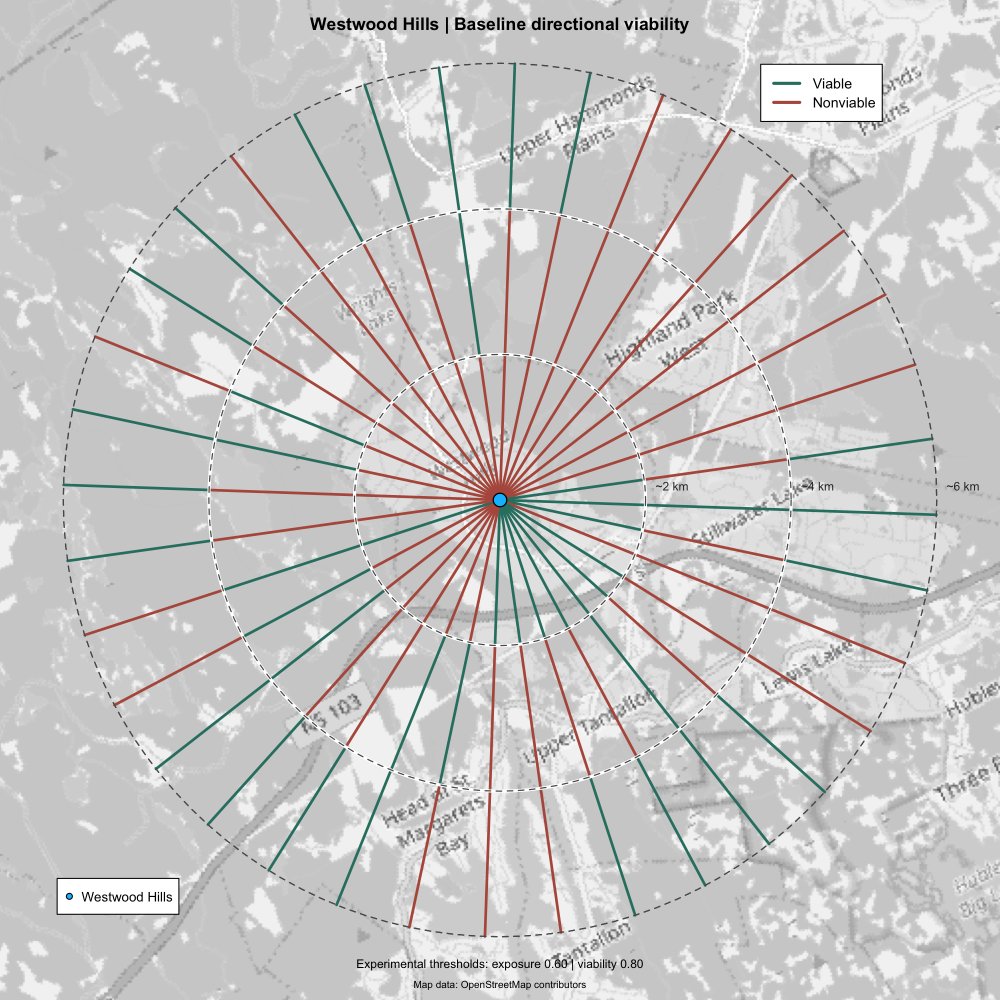

# D10 — Directional viability and threshold stability

**Date:** 2026-10-26
**Status:** Initial directional visualization complete

## Purpose

Examine how a directional assessment from Westwood Hills
changes when analytical thresholds are varied.

The experiment distinguishes a baseline binary
classification from sensitivity across a specified
grid of analytical thresholds.

## Geographic and analytical setup

- Reference location: Westwood Hills, Nova Scotia.
- Coordinate reference system: EPSG:3978.
- Input: D09 2026 experimental reference exposure raster.
- Bearings: 10 to 360 degrees in 10-degree increments.
- Three successive nominal 2 km segments per bearing.
- Actual returned segments are approximately 2,038 m each.
- Total: 108 directional segments.

The assessment uses the geometry returned by
`fireexposuR::fire_exp_dir()`.

It does not independently reconstruct the geographic
directional lines.

## Baseline assessment

Experimental parameters:

- Exposure threshold: 0.60.
- Viability threshold: 0.80.

Results:

- Viable: 42 of 108 segments.
- Nonviable: 66 of 108 segments.
- Inner segment: 11 viable.
- Middle segment: 10 viable.
- Outer segment: 21 viable.

The reconstructed directional-support implementation
agreed with all 108 classifications returned by
`fire_exp_dir()`.

The exact line-raster intersection analysis reported
complete calculated exposure coverage for all
108 segments.

Complete exposure-raster coverage does not establish
that the underlying fuel evidence is accurate,
current, or complete.

## Threshold-grid assessment

The experiment evaluates 72 combinations:

- Exposure threshold: 0.40 to 0.80, step 0.05.
- Viability threshold: 0.60 to 0.95, step 0.05.

Total evaluations: 7,776.

All 7,776 reconstructed classifications agreed with
the corresponding `fire_exp_dir()` classifications.

Results across the 108 segments:

- Never viable: 21.
- Variable: 79.
- Always viable: 8.

Mean viable fractions by distance group:

- Inner: 0.2966821.
- Middle: 0.3564815.
- Outer: 0.5763889.

The original baseline classifications were reproduced
exactly within the threshold grid.

## Selected figures

### Picture A — Baseline directional viability

Red and teal represent nonviable and viable segments
under the baseline experimental thresholds.

### Picture B — Threshold-grid viable fraction

Five ordered colours represent the fraction of
72 tested threshold combinations in which each
segment is classified as viable.

Both figures share the same directional geometry,
geographic extent, grayscale OpenStreetMap basemap,
reference point, and approximate distance rings.

## Interpretation

The baseline map communicates one selected assessment.

The threshold-grid map communicates sensitivity of
that assessment to the chosen analytical thresholds.

An outer viable segment does not imply a continuously
viable path from the reference location.

The threshold-grid viable fraction is not a
probability of correctness, wildfire occurrence,
exposure, or operational safety.

Neither map predicts a wildfire spread direction.

## Reproduction

The retained analysis scripts are:

- `scripts/d10_baseline_directional_assessment.R`
- `scripts/d10_integrated_directional_assessment.R`
- `scripts/d10_threshold_stability.R`

The retained renderers are:

- `scripts/d10_render_baseline_directions_v4.R`
- `scripts/d10_render_threshold_stability.R`

The resulting CSVs are stored under `outputs/tables/`.

Basemaps are externally supplied and cached locally.
Exact cross-environment rendering reproducibility
has not been established.

## Next investigation

Examine directional sensitivity to alternative fuel
representations, including the 2024 and 2026 FBP
classifications and unresolved input assignments.

The 2019 FBP representation and the documented
2023 Tantallon fire remain separate historical
investigations.
